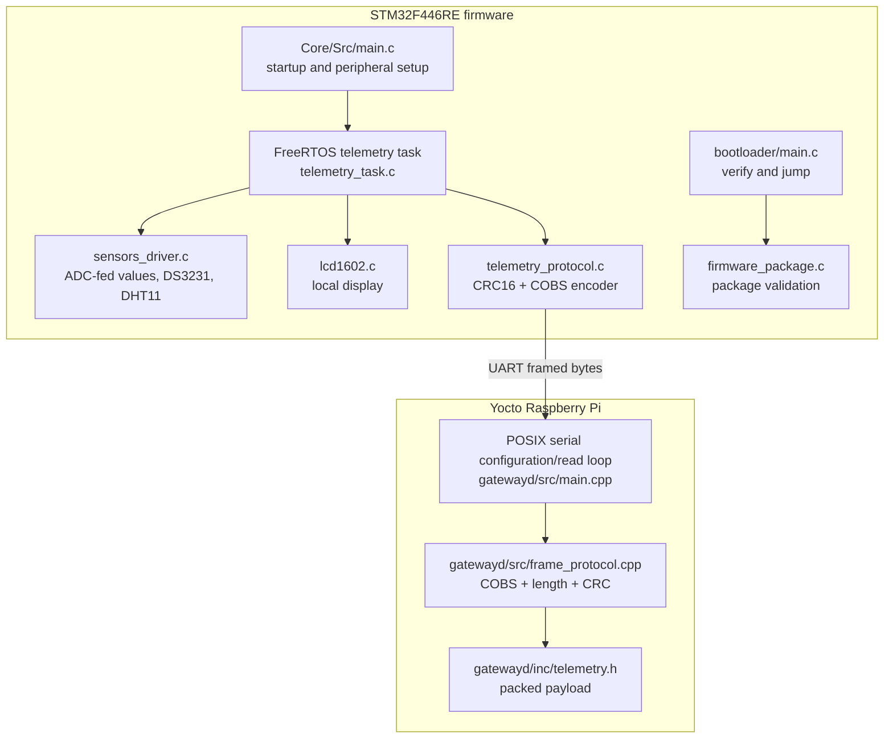

# Software Detailed Design

## Design status

This is a source-oriented detailed design of the current implementation. File
names and behavior are derived from the repository; the design does not imply
that every behavior has target-level verification. See the [traceability
matrix](v-model-traceability.md) for evidence and open verification items.

## Software decomposition

## STM32 application

### Startup and resource ownership

`Core/Src/main.c` owns process startup and HAL handles. It configures the clock,
GPIO, DMA, ADC1, I2C1, and USART2. ADC1 scans four channels continuously via
DMA into `adc_dma_buffer`; `HAL_ADC_ConvCpltCallback` in
`Core/Src/stm32f4xx_hal_msp.c` gives `xAdcDmaSemaphore` from ISR context.
Startup creates the binary semaphore, initializes the
sensor-driver handles/mutexes, creates `StartTelemetryTask` at
`tskIDLE_PRIORITY + 2`, and starts the FreeRTOS scheduler. Initialization
failures route to `Error_Handler`.

`StartTelemetryTask` owns the periodic sampling/format/transmit cycle. It waits
for the ADC semaphore up to the one-second period. If no ADC completion arrives,
it still sends a frame using the last payload values. `Sensors_Init` is called
from startup and again in the task; it stores the I2C handle and creates mutexes
only when their handles are null.

### Sensor acquisition and display

| Module | Interface / input | Behavior and output |
| --- | --- | --- |
| `sensors_driver.c` DS3231 | I2C1, 7-bit device address, protected by I2C mutex | Reads seven bytes starting at register 0; currently converts seconds/minutes/hours only. Returns failure when the handle, output, lock, or bus operation is unavailable. |
| `sensors_driver.c` DHT11 | GPIO single-wire, protected by DHT mutex | Issues the host start pulse, bounds response-edge waits, reads 40 bits, verifies checksum. Returns failure for invalid arguments, mutex timeout, edge timeout, or checksum error. |
| ADC in `main.c` / task | ADC1 + DMA2 stream 0 | Channels map to accelerometer X/Y/Z and a fourth photocell-intended slot. Acceleration uses `(raw - 2048) * 8058 / 3300`; the light field retains raw ADC counts. The README records that no photoresistor is currently connected. |
| Button in `telemetry_task.c` | GPIOC pin 13 | Active-low read; pressed is serialized as 1. |
| `lcd1602.c` | GPIO display interface | Writes two status lines; the telemetry task displays DHT status/temperature/humidity and light/button values. |

The telemetry task uses `INT8_MIN` and `UINT8_MAX` sentinels for failed DHT11
temperature and humidity. The gateway checks the humidity sentinel and prints
`DHT11=READ_ERROR` for that condition.

### Frame construction

`Core/Inc/telemetry.h` defines a packed 15-byte payload. The task constructs
`type (0x01) | length (15) | payload | CRC low | CRC high`, then calls
`telemetry_cobs_encode`, which appends the `0x00` frame delimiter. The result is
sent with `HAL_UART_Transmit` on USART2. The CRC implementation in
`telemetry_protocol.c` is CRC-16/MODBUS (`0xFFFF` initial value, `0xA001`
reflected polynomial).

The payload is copied using the packed C representation, which assumes the
STM32's little-endian byte order. Gateway code and test vectors currently use
the same wire representation. A future protocol revision should encode/decode
multibyte fields explicitly to avoid compiler/architecture layout assumptions.

## STM32 secure boot and package tools

`Core/Src/firmware_package.c` is the portable package validation module called
by `bootloader/main.c`. It performs header, bounds, board, signature, digest,
and vector validation. The bootloader obtains the package from the configured
application slot, checks the declared image size before passing the complete
package to the verifier, disables/clears interrupt state, points VTOR to the
application vector table, restores core masks/control state, sets MSP, and
branches to the reset handler. Any validation failure loops in
`boot_fail_closed`.

`tools/secure_firmware.py` builds, parses, verifies, inspects packages and
exports the public-key header; OpenSSL performs cryptographic signing/key
operations where used by the tool. `tools/flash_signed_stm32.sh` validates
arguments, paths, and package verification before calling the programming
command. Private key handling and programmer behavior need release/bench
controls beyond host unit tests.

## Linux gateway

### Process and serial loop

`gatewayd/src/main.cpp` parses either no arguments (default `/dev/ttyACM0`) or
`--serial DEVICE`. It configures a POSIX TTY at 115200 baud, 8 data bits, no
parity, one stop bit, and no software/hardware flow control. If opening or
configuring the device fails, it reports the problem and retries every two
seconds. On success it reads one byte at a time.

The serial loop accumulates nonzero bytes until a delimiter. Empty frames are
ignored. When the encoded-frame limit of 512 bytes is exceeded, the rest of the
frame is discarded through the next delimiter to resynchronize. Valid frames
with type `0x01` are passed to telemetry display; other valid types are ignored.
Invalid frames are written to stderr. The current read loop does not reconnect
after a post-open disconnect or read error.

### Protocol decoder and output

`gatewayd/src/frame_protocol.cpp` implements:

1. COBS decoding with a maximum decoded frame size of 259 bytes.
2. Raw frame minimum and exact-size checks (`raw length == payload length + 4`).
3. CRC-16/MODBUS validation over type, length, and payload.
4. Extraction of message type and payload bytes.

`gatewayd/inc/telemetry.h` defines the packed telemetry payload. `print_telemetry`
requires its exact size, copies into the structure, and prints timestamp,
three acceleration fields, raw ADC, DHT11 readings/error, and button state.
Output is plain text to stdout and is collected by systemd. There is no stable
machine-readable output interface defined yet.

## Build and deployment design

`gatewayd/CMakeLists.txt` builds the protocol library and daemon. The Yocto
recipe `meta-telemetry-bridge/recipes-apps/gatewayd/gatewayd_1.0.bb` packages
the daemon and `gatewayd.service`; the image recipe includes the package. The
service starts the daemon at boot and restarts it after exit. STM32 CMake
configuration uses an ARM toolchain and obtains CMSIS, HAL, FreeRTOS and crypto
dependencies through CMake FetchContent; the boot public key is supplied as a
build input and exported into a generated header.

## Concurrency, timing, and error behavior

- The telemetry task is the only implemented telemetry producer and UART
  writer. It is periodic at a nominal 1 Hz.
- ADC sample ownership is shared through a DMA buffer; the task waits on a
  binary semaphore before reading it. This does not snapshot the entire buffer
  atomically, so DMA/task read coherence should be assessed if sample consistency
  becomes a requirement.
- I2C and DHT11 access use separate FreeRTOS mutexes. DHT11 edge waits are
  bounded, but timing is performed in a critical section and requires hardware
  validation.
- Firmware fatal peripheral/task setup errors call `Error_Handler`; sensor
  read errors produce sentinels/fallback timestamps and do not stop telemetry.
- Gateway serial open/configuration failures retry. Frame failures are logged
  and the next delimiter provides framing recovery. A read-side disconnect is
  not currently recovered by reopening the port.
- systemd restarts the daemon if it exits; the daemon itself is an infinite
  process during normal operation.

### Hardware reliability/performance screening

`tests/hil/test_gateway_reliability.py` observes the deployed gateway journal
over SSH for 60 seconds by default. It groups real telemetry log records,
checks acceleration/ADC/button/DHT fields and broad representable ranges,
calculates observed frame rate and largest inter-frame gap, and compares the
gateway's systemd restart count before and after capture. It also records
average CPU time as a percentage of one core and process RSS at the start/end
plus process high-water RSS. Resource values are observational until product
budgets are approved. The initial screening thresholds are 0.8 frames/second
minimum and a 3 second maximum gap; both are configurable and provisional until
product-level timing requirements are approved. The check is read-only and does
not validate sensor calibration, electrical margins, reset behavior, or
long-term reliability.

## Related documents

- [System architecture](system-architecture.md)
- [V-model traceability](v-model-traceability.md)
