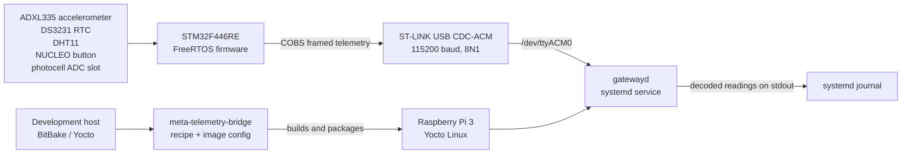

# System Architecture

## Purpose and scope

This document describes the current telemetry bridge implementation: the STM32F446RE
firmware, the USB serial connection, the Raspberry Pi Yocto image, and the
development/build path. It is an as-built view of repository behavior, not a
product safety case or an approved product requirements specification.

## System context

The runtime telemetry path is one way, from STM32 to Raspberry Pi. There is no
implemented command channel, MQTT/HTTP endpoint, or persistent application
database. The development host and Yocto layer are build/deployment elements,
not processes in the telemetry path. NFS, when used by the development setup,
provides a separate root-filesystem path and does not transport telemetry.

## Deployment view

| Node | Deployed software or hardware | Responsibility |
| --- | --- | --- |
| STM32F446RE NUCLEO | STM32 application, FreeRTOS, HAL, sensor/display drivers | Acquire and format telemetry; display selected values; transmit frames on USART2. |
| Raspberry Pi 3 | Yocto Linux image, `gatewayd`, `gatewayd.service` | Read serial data, validate frames, print recognized telemetry. systemd captures daemon output in the journal. |
| Build host | Yocto/BitBake build environment and `meta-telemetry-bridge` | Build the gateway package/image and support image deployment. |
| Sensors/peripherals | ADXL335, DS3231, DHT11, button, LCD1602, fourth ADC slot intended for photocell | Supply inputs and local feedback to firmware. The README notes no photoresistor is currently connected. |

The Yocto recipe installs the daemon and systemd unit, and enables the service
for the image. The service runs `/usr/bin/gatewayd` as root with a restart
policy. The daemon defaults to `/dev/ttyACM0`; `--serial DEVICE` allows another
device path, including a PTY in host integration tests.

## Runtime data flow

1. STM32 startup initializes HAL, clock, GPIO, DMA, ADC1, I2C1, and USART2; it
   emits the diagnostic text `STM32 UART READY` and starts the display, sensor
   synchronization objects, and FreeRTOS telemetry task.
2. ADC1 scans three accelerometer axes and a fourth photocell-intended channel
   using DMA. The telemetry task reads DS3231 time, DHT11 temperature/humidity,
   and the active-low button state. It updates the LCD and sends telemetry at a
   nominal 1 Hz cadence.
3. The firmware serializes a packed 15-byte telemetry payload. It prepends a
   message type and one-byte payload length, appends CRC-16/MODBUS (low byte
   first), COBS-encodes the raw frame, and appends a `0x00` delimiter.
4. `gatewayd` configures the serial port for 115200 baud, 8N1, reads the byte
   stream, splits it on `0x00`, and decodes/validates each frame. Encoded frames
   longer than 512 bytes are discarded through the next delimiter.
5. A valid frame with telemetry message type `0x01` and the expected payload
   size is copied to the packed gateway telemetry structure and printed to
   stdout. Other valid message types are ignored. Invalid frames are logged;
   systemd records stdout/stderr in the journal.

The one-second task cadence is nominal. Sensor bus timing, task scheduling, and
UART transmission contribute to actual timing. The DS3231 driver currently
converts only the hour/minute/second fields into seconds since midnight despite
some comments naming the value a Unix timestamp. Consumers must not treat it as
epoch time until this implementation/contract mismatch is resolved.

## Protocol interface

The current message header is `type:u8, payload_length:u8`; the CRC covers that
header and payload. CRC-16/MODBUS uses initial value `0xFFFF`, reflected
polynomial `0xA001`, and little-endian wire order. COBS encoding removes zero
bytes from the encoded body; a zero delimiter terminates each frame.

| Field | Wire representation | Current telemetry meaning |
| --- | --- | --- |
| Type | 1 byte | `0x01` telemetry |
| Length | 1 byte | `15` bytes |
| Timestamp | `uint32`, little-endian | DS3231-derived seconds since midnight, or FreeRTOS uptime seconds if RTC read fails |
| Acceleration X/Y/Z | three `int16`, little-endian | milli-g values derived from ADC samples |
| Light | `uint16`, little-endian | raw ADC channel 4 slot (field name says `light_lux_raw`; not calibrated lux). The current README notes that no photoresistor is connected. |
| Temperature | `int8` | degrees Celsius; `INT8_MIN` is sent on DHT11 read failure |
| Humidity | `uint8` | relative humidity percent; `UINT8_MAX` is sent on DHT11 read failure |
| Button | `uint8` | 1 when pressed, 0 otherwise |
| CRC | two bytes, low byte first | CRC over type, length, and payload |

The packed payload is defined independently in firmware and gateway headers.
The protocol test vectors in `tests/fixtures/protocol_vectors.json` are the
shared reference for encoded examples. Any wire-format change must update both
implementations and the vectors together.

## Firmware memory and secure boot

The repository contains a bootloader package verifier and application image
layout definitions. Firmware packages have a 512-byte header followed by the
application image. The package verifier checks package bounds, magic/version,
board ID, reserved bytes, image size, Ed25519 signature, BLAKE2b digest, and the
application vector table before returning the stack pointer and reset handler.
The bootloader fails closed if verification fails, then sets the vector table
and transfers control to the verified application.

The signed-package tool prepares and inspects package artifacts; the flashing
script verifies its inputs before invoking the programmer. Private signing keys
are build/release inputs and must not be committed. See the README secure
firmware sections for the package and flash workflow.

## Architectural boundaries and known limitations

- Telemetry is currently device-to-host only; message type constants for alarm
  and command do not imply those message paths are implemented.
- `gatewayd` retries when it cannot initially open the serial device. Its main
  read loop does not currently reopen the port after a later read-side
  disconnect/error.
- DHT11 acquisition uses a timing-sensitive critical section. Hardware timing
  and sensor accuracy require target/bench verification beyond host unit tests.
- Host integration tests exercise the daemon through PTYs. System checks run
  against an SSH-accessible Yocto target. Neither level validates electrical
  characteristics or real sensor calibration.
- The repository also contains `linux-gateway/src/gateway_receiver.c`; its
  relationship to the packaged `gatewayd` path should be settled before it is
  considered an alternate production implementation.

## Related documents

- [Software detailed design](software-detailed-design.md)
- [V-model traceability](v-model-traceability.md)
- [README system architecture](../../README.md#system-architecture)
