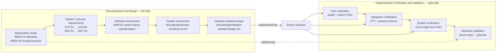

# V-Model Traceability

## Purpose and status

This matrix connects derived product needs to software requirements, design,
implementation, and verification evidence. The requirement statements below
are a working baseline inferred from the current repository behavior. They are
not yet an approved customer or regulatory specification. Review and baseline
them with stakeholders before using them as contractual acceptance criteria.

Traceability is bidirectional: each requirement points to its implementation
and verification, and each test identifies the behavior it verifies. A linked
test proves only the listed behavior at its stated test level; host tests do
not establish sensor accuracy, electrical compatibility, or full target
reliability.

## V-model view

The left side defines what the system should do and how its software is
decomposed. The right side checks the corresponding implementation at
increasingly integrated levels. A complete V-model lifecycle still needs
approved requirements, explicit design reviews, baselined test specifications,
and recorded target/HIL results.

## Requirement-to-test mapping

| ID | Parent | Derived requirement | Design allocation | Implementation | Verification evidence | Status / remaining evidence |
| --- | --- | --- | --- | --- | --- |
| SYS-01 | NEED-01 | The embedded node shall acquire configured analog and digital sensor inputs and make the values available to the telemetry producer. | Architecture: STM32 node; detailed design: sensor acquisition and display | `stm32-firmware/Core/Src/main.c`, `sensors_driver.c`, `telemetry_task.c` | `tests/unit/stm32-firmware/Core/Src/sensors_driver_test.c` exercises sensor-driver branches with fakes. | Host unit evidence exists. Verify channel wiring, sensor accuracy, and sampling behavior on the assembled hardware. |
| SYS-02 | NEED-01 | The firmware shall emit telemetry using the documented frame delimiter, COBS encoding, payload layout, and CRC-16/MODBUS. | Architecture: protocol interface; detailed design: frame construction | `Core/Src/telemetry_task.c`, `Core/Src/telemetry_protocol.c`, `Core/Inc/telemetry.h` | `tests/unit/stm32-firmware/Core/Src/telemetry_protocol_test.c`; shared vectors in `tests/fixtures/protocol_vectors.json`; `tests/integration/test_gateway_serial.py::test_daemon_reads_partial_frames_recovers_and_decodes` | Host protocol and PTY evidence exists. Confirm bytes from the target UART against the shared vector in HIL. |
| SYS-03 | NEED-01 | The gateway shall reject malformed, length-inconsistent, oversized, or CRC-invalid frames and resynchronize at a frame delimiter. | Architecture: Linux gateway; detailed design: protocol decoder and serial loop | `gatewayd/src/frame_protocol.cpp`, `gatewayd/src/main.cpp` | `tests/unit/gatewayd/src/frame_protocol_test.cpp`; integration tests `test_daemon_reads_partial_frames_recovers_and_decodes` and `test_daemon_discards_oversized_frame_then_recovers` | Native and PTY evidence exists. Add target disconnect/reopen behavior only if required; current daemon does not reopen after read-side disconnect. |
| SYS-04 | NEED-01 | The gateway shall decode telemetry type `0x01` with the expected payload size and expose readings in service output; valid unrecognized types shall not be reported as telemetry. | Architecture: Pi gateway/journal; detailed design: gateway output | `gatewayd/src/main.cpp`, `gatewayd/inc/telemetry.h`, `gatewayd.service` | `tests/integration/test_gateway_serial.py::test_daemon_ignores_unknown_type_and_wrong_payload_size`; `tests/system/test_gateway_service.py::test_yocto_gateway_journal_contains_decoded_telemetry` | Host and configured-target evidence exists. Define a stable downstream output API if consumers need machine-readable readings. |
| SYS-05 | NEED-01 | The gateway process shall use the configured serial device and tolerate that device being unavailable at initial startup by retrying the connection. | Architecture: serial deployment interface; detailed design: process and serial loop | `gatewayd/src/main.cpp`; `gatewayd.service` | `tests/integration/test_gateway_serial.py::test_daemon_reconnects_when_serial_device_appears`; `tests/system/test_gateway_service.py::test_yocto_gateway_service_and_serial_device` | Initial-connect retry is covered. Recovery from a device disappearing after connection is not implemented or verified. |
| SYS-06 | NEED-01 | The Yocto image shall install and enable the gateway service with the configured restart policy. | Architecture: deployment view; detailed design: build and deployment | `meta-telemetry-bridge/recipes-apps/gatewayd/gatewayd_1.0.bb`, `gatewayd.service`, image recipe | `tests/system/test_gateway_service.py::test_yocto_gateway_service_is_enabled_and_restart_configured` | SSH target check exists. Preserve target image/revision and test logs as release evidence. |
| SEC-01 | NEED-02 | The bootloader shall transfer control only to a package matching the supported header/board/image constraints and passing signature, digest, and vector validation. | Architecture: firmware memory and secure boot; detailed design: secure boot and package tools | `stm32-firmware/Core/Src/firmware_package.c`, `stm32-firmware/bootloader/main.c` | `tests/unit/stm32-firmware/Core/Src/firmware_package_test.c` | Native verifier tests exist. Hardware boot acceptance/rejection and protected-key behavior require a controlled HIL/release bench. |
| SEC-02 | NEED-02 | The host package tool shall reject malformed or tampered packages and support creation/inspection using the expected board and key inputs. | Detailed design: secure boot and package tools | `stm32-firmware/tools/secure_firmware.py` | `tests/unit/stm32-firmware/tools/test_secure_firmware.py`, including tamper rejection and parser boundary cases | Python unit evidence exists. Validate packaged release workflow and signing-key custody separately. |
| SEC-03 | NEED-02 | The flashing script shall validate arguments/files and verify a signed package before programming the target. | Detailed design: secure boot and package tools | `stm32-firmware/tools/flash_signed_stm32.sh` | `tests/unit/stm32-firmware/tools/test_flash_signed_stm32.py::test_flash_script_verifies_before_programming` and other argument/path cases | Script behavior is unit tested with a fake programmer. Successful programming and recovery are destructive bench tests and are not covered by the host suite. |
| SWR-01 | SYS-01, SYS-02 | When a sensor read fails, telemetry shall continue using the defined fallback/sentinel representation rather than silently interpreting the read as valid. | Detailed design: sensor acquisition and concurrency/error behavior | `sensors_driver.c`, `telemetry_task.c` | `tests/unit/stm32-firmware/Core/Src/sensors_driver_test.c`; `tests/system/test_gateway_service.py::test_yocto_gateway_journal_contains_decoded_telemetry` | Partial host coverage exists. Explicitly test every sentinel/fallback over UART on target and finalize the timestamp contract. |
| SYS-07 | NEED-01 | During a physical observation, each telemetry record shall contain parseable acceleration, ADC, button, and DHT11 value or explicit DHT11 error fields within their wire representation ranges. | Architecture: runtime data flow; detailed design: sensor acquisition and frame output | `stm32-firmware/Core/Src/telemetry_task.c`, `gatewayd/src/main.cpp` | `tests/hil/test_gateway_reliability.py::test_hil_telemetry_continuity_rate_and_service_stability` | HIL checks field presence and representable/range constraints over real hardware. It does not establish sensor calibration or accuracy. |
| PERF-01 | NEED-01 | Over a 60-second observation, decoded telemetry shall average at least 0.8 frames/s and no adjacent frame gap shall exceed 3 seconds; record gateway CPU and memory observations. | Architecture: nominal 1 Hz telemetry flow; detailed design: periodic sampling, gateway serial loop, and HIL screening | `stm32-firmware/Core/Src/telemetry_task.c`, `gatewayd/src/main.cpp` | `tests/hil/test_gateway_reliability.py::test_hil_telemetry_continuity_rate_and_service_stability` | Provisional rate/gap thresholds used for this bench run; CPU and memory are informational until budgets are approved. |
| REL-01 | NEED-01 | During the observation window, `gatewayd` shall remain active and its systemd restart count shall not increase. | Architecture: Pi gateway deployment; detailed design: process and service behavior | `gatewayd/src/main.cpp`, `meta-telemetry-bridge/recipes-apps/gatewayd/files/gatewayd.service` | `tests/hil/test_gateway_reliability.py::test_hil_telemetry_continuity_rate_and_service_stability` | HIL check covers a short screening window. Add longer soak, power-cycle, and physical disconnect/recovery campaigns before release. |

## Verification-level cross-reference

| Verification level | Test location / command | What it can establish | What it cannot establish alone |
| --- | --- | --- | --- |
| Unit | `tests/unit/`; run with `./run_host_tests.sh` | Isolated parser, protocol, package-verifier, sensor-driver, and script behavior for tested inputs. | Real hardware timing, electrical behavior, service deployment, or whole-system compatibility. |
| Integration | `tests/integration/test_gateway_serial.py` with host `gatewayd` and PTYs | Serial byte stream handling, framing, malformed/oversized recovery, message filtering, and initial device retry. | Actual Pi USB enumeration or STM32 sensor/UART output. |
| System | `tests/system/test_gateway_service.py` with `YOCTO_SSH_HOST` | Deployed service state/configuration, serial node presence, and journal output on the selected image. | Sensor calibration or behavior under physical disconnect/EMI unless the test setup explicitly exercises it. |
| HIL | `tests/hil/test_gateway_reliability.py`; run through `./run_host_tests.sh` with `YOCTO_SSH_HOST` set | Real Pi/STM32 telemetry field presence, observed frame rate/gaps, and gateway service restart stability during the configured capture. | Sensor accuracy/calibration, UART electrical margins, reset/power-cycle recovery, and long-term reliability. |

`./run_host_tests.sh` includes unit, integration, system, and HIL pytest markers
in one pytest run, then runs native CTest targets and creates coverage artifacts.
System and HIL cases skip when `YOCTO_SSH_HOST` is absent. Skips are not passed
results; reports should retain each case's result and reason.

## Open traceability actions

1. Review the derived requirements and assign a revision/approval owner.
2. Define requirements for timing, valid sensor ranges, timestamp epoch/timezone,
   behavior when the serial link drops after connection, and data retention/API.
3. Decide whether `linux-gateway/src/gateway_receiver.c` is supported software
   or legacy code. If supported, add architecture and test links for it.
4. Extend identified HIL procedures and map recorded results to SYS-01,
   SYS-02, SEC-01, SWR-01, SYS-07, PERF-01, and REL-01.
5. At release, record the tested firmware/image commit, board identity,
   configuration, test report, and any approved deviations.

## Related documents

- [System architecture](system-architecture.md)
- [Software detailed design](software-detailed-design.md)
- [README testing strategy](../../README.md#testing-strategy)
